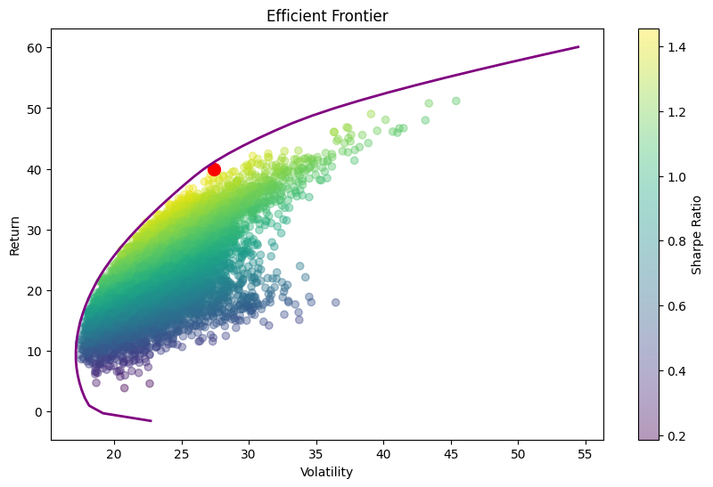
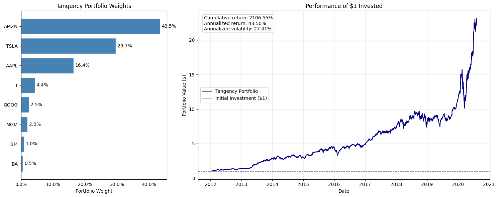
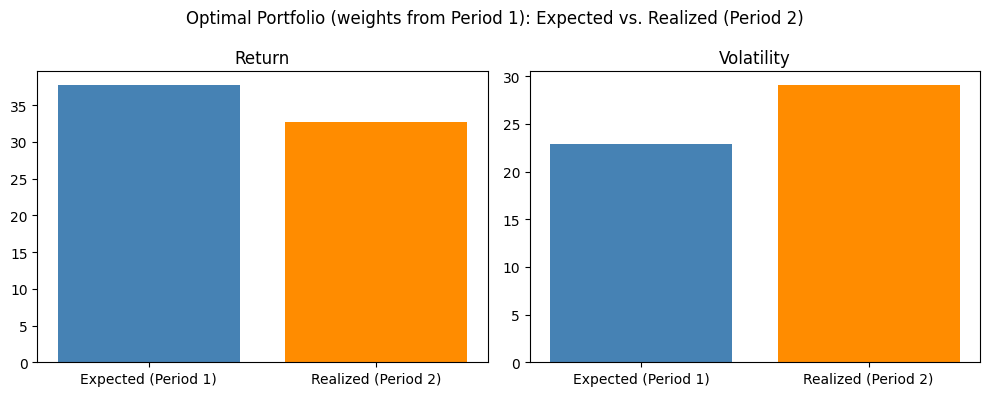
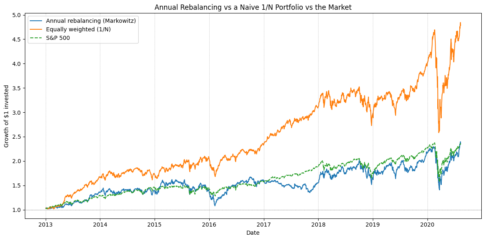
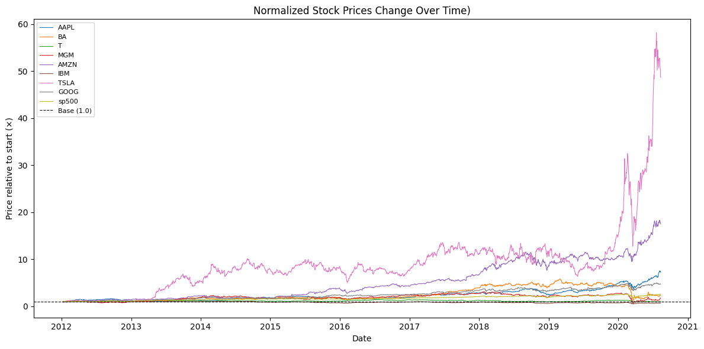

# Lab 1: Markowitz Portfolio Optimization

**Question.** A fund manager wants the optimal (tangency) portfolio of eight large US stocks: AAPL, BA, T, MGM, AMZN, IBM, TSLA and GOOG. Does a Markowitz mean–variance approach beat a passive S&P 500 investment, and does it still work out of sample?

📓 Notebook: [`PCLab1_Markowitz_Portfolio.ipynb`](PCLab1_Markowitz_Portfolio.ipynb)

## Data

Daily closing prices of the 8 stocks and the S&P 500 index, 12 Jan 2012 – Aug 2020 (2,159 trading days), with no missing values. The file was provided with the course and is **not included** (see [Data](#data-not-included)).

## What we did

1. **Describe and plot the sample.** Raw and normalized prices, daily returns, a correlation heatmap and return distributions.
2. **Find the tangency portfolio.** We simulated 10,000 long-only portfolios with Dirichlet weights (rf = 0) and kept the one with the highest Sharpe ratio. We also traced the exact efficient frontier with constrained optimization (SLSQP).
3. **Test it out of sample.** We estimated weights on 2012–2015 only and applied them unchanged to 2016–2020.
4. **Extension: annual rebalancing.** Each year we re-optimized using only the previous year's data, then compared the result with a naive 1/N portfolio and the S&P 500.

## Key findings

| | Return (ann.) | Volatility (ann.) | Sharpe |
|---|---:|---:|---:|
| Tangency portfolio, full sample (in-sample) | 39.9% | 27.4% | **1.46** |
| Weights from 2012–15: *expected* | 37.7% | 22.9% | 1.65 |
| Same weights applied to 2016–20: *realized* | 32.7% | 29.1% | **1.12** |
| Annual re-optimization (2013–2020) | 14.2% | 24.0% | 0.59 |
| Equally weighted 1/N (2013–2020) | 23.1% | 22.3% | **1.04** |
| S&P 500 (2013–2020) | 12.6% | 17.1% | 0.74 |

- **The optimizer concentrates on recent winners.** The full-sample tangency portfolio is about 90% in three growth stocks: AMZN 43.5%, TSLA 29.7% and AAPL 16.4%. In sample, $1 grows to about $22, against about $2.50 for the S&P 500.
- **In-sample performance overstates real performance.** With weights frozen from 2012–2015, realized return fell and volatility rose, so the Sharpe ratio dropped from 1.65 to 1.12, about 32% lower. The strategy still beat the S&P 500, ending at about 3.5× against 1.6×.
- **Weights are unstable.** The optimal portfolio changes a lot between periods. For example, BA gets 25% in 2012–15 and about 1% in 2016–20, while AMZN rises from 37% to 62%.
- **Estimation error outweighs the gains from optimization.** Re-optimizing every year on one year of data puts 33–77% of the portfolio into a single stock that keeps changing. This strategy barely matches the index, and the naive 1/N portfolio more than doubles its final wealth ($4.79 vs $2.36 per $1).
- **Stylized facts.** Every stock is positively correlated with the market, most strongly IBM (0.70) and GOOG (0.68), least TSLA (0.39). Return distributions have fat tails, and volatility clusters in time, most visibly in the COVID crash.

**Takeaway:** mean–variance optimization is only as good as its inputs. Historical means and covariances are noisy estimates, so in-sample Sharpe ratios are an upper bound, and naive diversification is hard to beat.

## Figures

| Efficient frontier | Tangency portfolio |
|---|---|
|  |  |

| Expected vs realized (out of sample) | Annual rebalancing vs 1/N vs S&P 500 |
|---|---|
|  |  |

## Data (not included)

| File | Content | Source |
|---|---|---|
| `Data_PCLab1_Stock.csv` | Daily closing prices: `Date`, 8 tickers, `sp500` | Course material (not redistributed) |

To re-run the notebook, place the file next to it. Similar data can be downloaded from Yahoo Finance, although the numbers may differ slightly.
