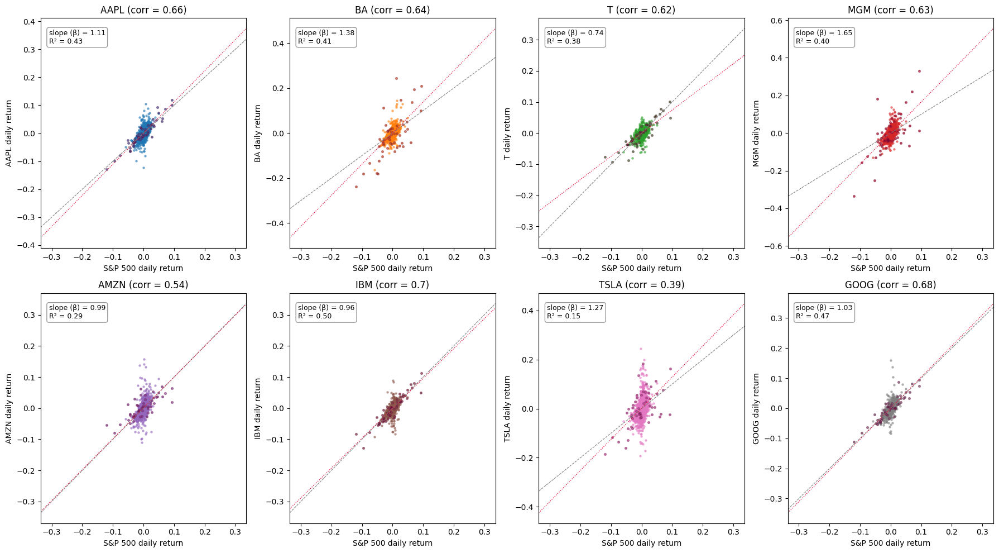
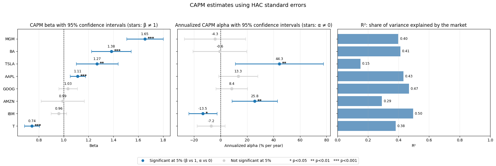
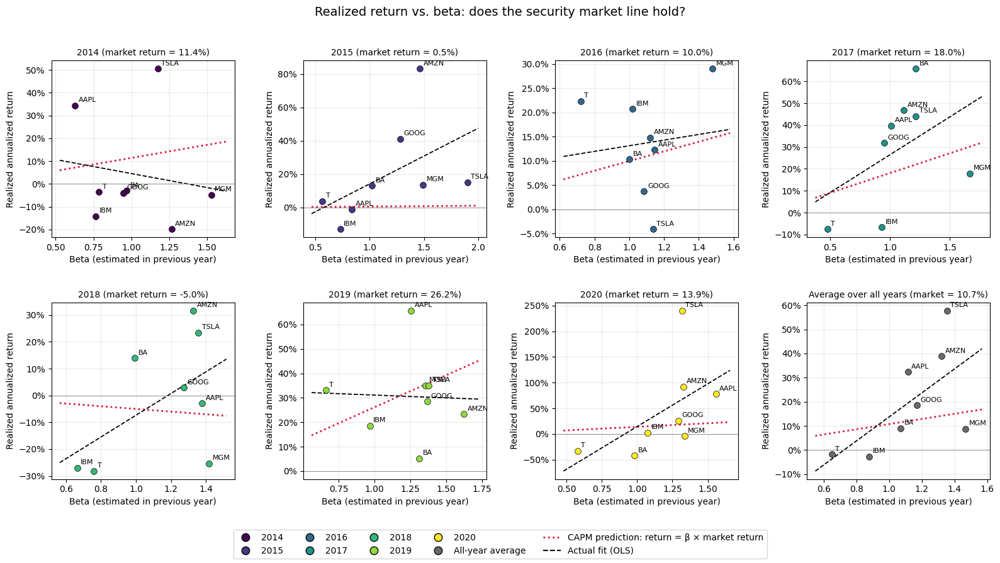
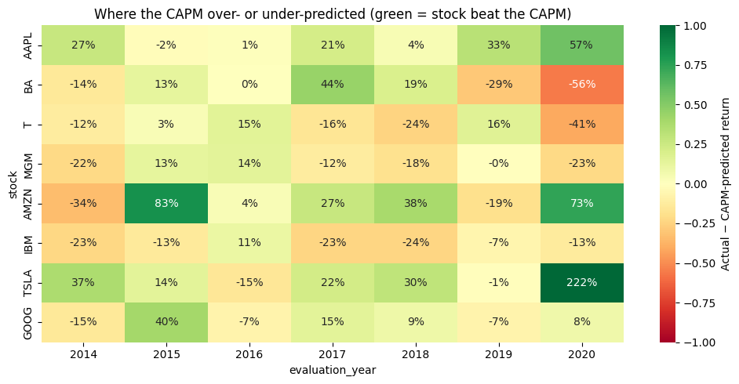
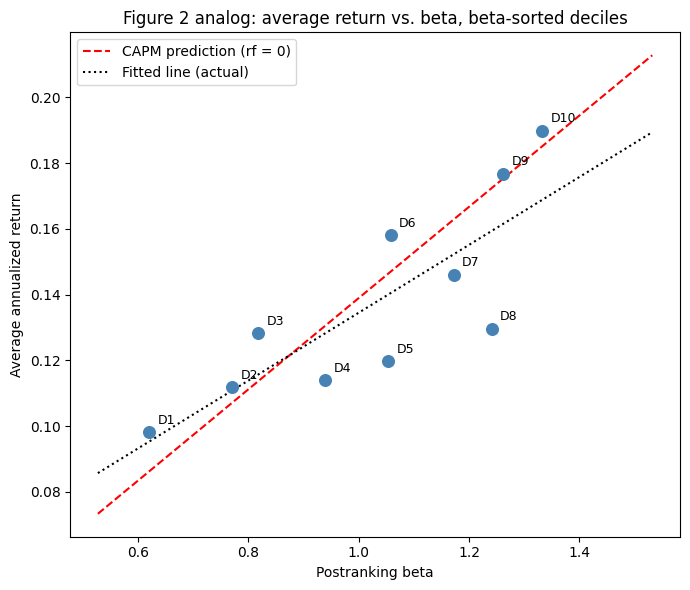

# Lab 2: Testing the CAPM

**Question.** Does the Capital Asset Pricing Model explain the returns of eight large US stocks (AAPL, BA, T, MGM, AMZN, IBM, TSLA, GOOG) against the S&P 500? Does the result hold across the whole S&P 500 universe? In the optional part we follow Fama & French (2004), *The Capital Asset Pricing Model: Theory and Evidence*.

📓 Notebook: [`PCLab2_CAPM.ipynb`](PCLab2_CAPM.ipynb)

## Data

- **Tasks 1–3:** daily closing prices of the 8 stocks and the S&P 500, Jan 2012 – summer 2020. This is the course file, not included.
- **Optional part:** the daily CRSP panel of S&P 500 constituents, 2007–2023, downloaded from WRDS (about 2.15M stock-days, 873 firms), not included. We used CRSP rather than scraping Wikipedia and Yahoo Finance to avoid a double **survivorship bias**: Wikipedia lists only current members, and Yahoo generally drops delisted firms. CRSP keeps delisted firms under a permanent ID (PERMNO) and provides total returns and market caps.

## What we did

1. **Visualization.** Scatter plots of each stock against the market, and 63-day rolling correlations.
2. **Alpha and beta.** We ran a full-period OLS CAPM regression for each stock (rf = 0) and checked the residuals: Q–Q plots, Jarque–Bera, Breusch–Pagan, White and Breusch–Godfrey tests. Because the residuals failed these tests, we re-estimated with HAC (Newey–West) standard errors. We also built the "boss's" high-beta portfolio.
3. **Testing the CAPM year by year.** Each year we predicted returns from the previous year's beta and the market return realized that year. We looked at prediction errors, the security market line (SML) by year, beta stability, high- vs low-beta groups, and estimation windows from 63 to 504 days.
4. **Optional: paper recreation.** We sorted about 470 stocks into beta deciles (Fama–French Figure 2), estimated Fama–MacBeth cross-sectional regressions, and ran the GRS test.

## Key findings

**Task 1–2: Beta is precise, alpha is not.**
- Full-period betas range from **0.74 (T)** to **1.65 (MGM)** and are all highly significant. MGM, BA, TSLA and AAPL are significantly riskier than the market (β > 1). T is the only significantly defensive stock.
- Alpha is statistically zero for 5 of the 8 stocks, as the CAPM predicts. The exceptions are **TSLA (+44%/yr)** and **AMZN (+26%/yr)**, which beat their benchmark, and **IBM (−13%/yr)**, which lagged it.
- The market explains only **15–50%** of daily variance (R²). The rest is idiosyncratic risk.
- The residuals are fat-tailed (excess kurtosis 5.8–31.4) and heteroskedastic, and some are autocorrelated. HAC standard errors widen the confidence intervals but change no conclusion.
- The high-beta portfolio (MGM, BA, TSLA, AAPL; β = 1.35) was predicted to earn **16.8%/yr** and actually earned **30.0%**. The gap comes almost entirely from TSLA's alpha, not from market risk.

**Task 3: The CAPM is a poor year-by-year forecaster.**
- Mean absolute prediction error is about **25 percentage points** per stock-year.
- The slope of return on beta is unstable: it is negative in 2014 and 2019, and positive in 2018 even though the market fell. It is also insignificant (t ≈ 1.7) and driven by 2020.
- Errors persist by firm. TSLA, AMZN and AAPL beat the CAPM in most years and IBM fell short in almost every year, which points to missing factors such as growth vs value.
- Yearly betas are noisy and drift; for example, AAPL moves from about 0.6 to 1.6. A **3-month window destroys the beta–return relation**, while 1–2 years works best. No window reduces the prediction errors, because those come from idiosyncratic risk.

**Optional: With portfolios, the picture is cleaner.**
- Postranking betas of the beta deciles spread from **0.62 to 1.33**, and average returns rise almost linearly with beta (9.8% → 19.0%/yr).
- The flat SML documented by Fama & French appears only faintly. The **GRS test does not reject** that all decile alphas are zero (F = 1.15, **p = 0.32**).
- The Fama–MacBeth beta premium is positive but not significant (0.65%/month, **t = 1.34**).
- We could not replicate the book-to-market evidence, which requires Compustat.

**Overall:** beta is a meaningful, precisely estimated measure of market exposure, and higher-beta portfolios did earn more on average. But beta alone is a poor guide to what an individual stock will earn in a given year, it varies over time, and persistent firm-level errors suggest that other sources of risk matter.

*Limitations:* rf = 0, the S&P 500 as a market proxy (Roll's critique), price-only returns in the course data, a partial 2020, and a small, non-random set of 8 stocks.

## Figures

| CAPM regressions (daily returns) | Beta, alpha and R² with HAC 95% CIs |
|---|---|
|  |  |

| Realized return vs beta, by year | CAPM prediction errors by stock and year |
|---|---|
|  |  |

## Data (not included)

| File | Content | Source |
|---|---|---|
| `Data_Stock.csv` | Daily closing prices of the 8 stocks + `sp500` | Course material (not redistributed) |
| `crsp_sp500_2007_2023.csv.gz` | CRSP daily stock file, S&P 500 constituents 2007–2023 | WRDS (licensed, requires a subscription) |

To re-run the notebook, place both files next to it. Notebook outputs that displayed raw CRSP rows have been removed.
