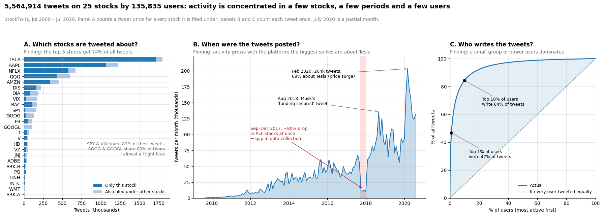
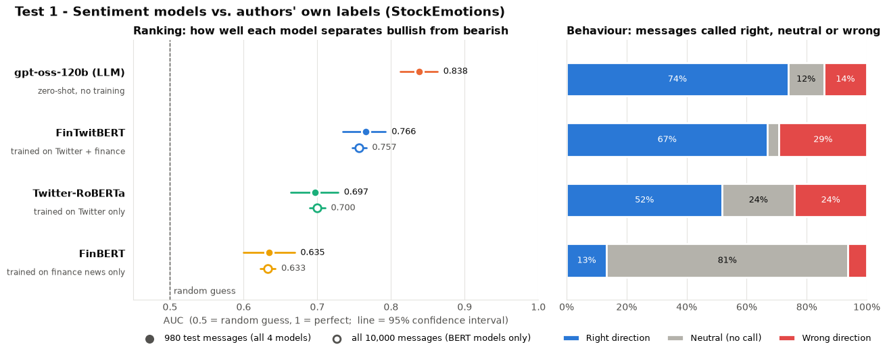
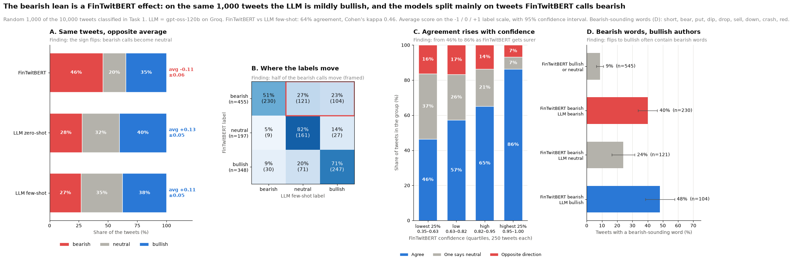
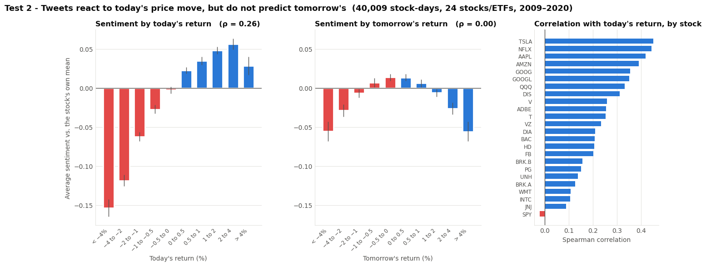
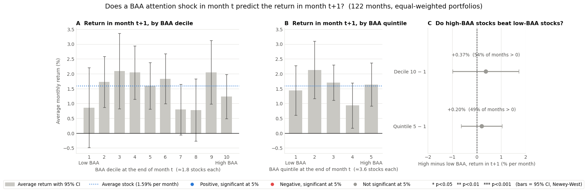

# Lab 3: StockTwits Sentiment and Media Attention

**Question.** What do 5.5 million StockTwits messages say about the stocks they discuss? Which NLP model measures their sentiment best? Do sentiment and abnormal attention predict stock returns?

📓 Notebook: [`PCLab3_StockTwits_Sentiment.ipynb`](PCLab3_StockTwits_Sentiment.ipynb) (outputs cleared, see [Data](#data-not-included))

## Data

- **StockTwits messages** on 25 tickers, Jul 2009 – Jul 2020: **5,564,914 unique tweets** from **135,835 users**. Course-provided; **not included and not redistributed**.
- **StockEmotions**: 10,000 messages labelled bullish or bearish by their authors, used as an external benchmark. Public, loaded directly from [GitHub](https://github.com/adlnlp/StockEmotions).
- **Prices** from Yahoo Finance (`yfinance`), **Fama–French 5 factors** from Ken French's data library, and the **CRSP** S&P 500 panel from Lab 2 (WRDS, licensed, not included).

## What we did

| Task | Content |
|---|---|
| 1 | Cleaning (6.48M raw rows: exact duplicates removed, cross-listed tweets kept in a separate tweet–stock table, HTML codes and links removed), descriptive statistics, sentiment by stock and year, ambiguity checks, LLM robustness check |
| 3 | Model selection: **FinBERT**, **Twitter-RoBERTa**, **FinTwitBERT** and an LLM (**gpt-oss-120b** via Groq), evaluated on StockEmotions and on our own data |
| 2 | Emoji handling, tokenization, stopword removal and lemmatization (keeping tickers, negations, direction words and CAPS), word clouds of distinctive bullish and bearish vocabulary |
| 4 | A **Broad Abnormal Attention (BAA)** factor, monthly rankings and decile/quintile portfolio sorts (attention in month *t*, returns in *t+1*) |
| 5 | Risk adjustment with the **Fama–French 5 factors**, Fama–MacBeth regressions, and a test of whether BAA is a new factor |

## Key findings

**The data is highly concentrated.** The top 5 tickers (TSLA, AAPL, NFLX, QQQ, AMZN) receive **74%** of tweets, and the top **1% of users write 47%** of them. Activity grows with the platform, and Sep–Dec 2017 is a data-collection gap rather than a real drop in activity.

**Model choice: FinTwitBERT, with the LLM as a robustness check.**

| Model | AUC, 10k StockEmotions | AUC, shared 980-message subset |
|---|---:|---:|
| FinBERT | 0.633 (80% predicted neutral) | – |
| Twitter-RoBERTa | 0.700 | – |
| FinTwitBERT | **0.757** | 0.766 |
| gpt-oss-120b (LLM) | – | **0.838** |

The LLM is the most accurate model, but scoring 5.56M tweets on the free API tier would take about 39 days. FinTwitBERT runs locally, is reproducible and returns class probabilities, so we used it for the full sample.

**The sentiment level depends on the model; relative patterns do not.** FinTwitBERT scores the sample as mildly **bearish (−0.11)**. On the same 1,000 tweets the LLM scores it as mildly **bullish (+0.11)**. FinTwitBERT reacts to words like *short*, *puts* or *bear* regardless of the author's position. Both models agree that index products (SPY, QQQ, DIA, VIX) are less positive than single stocks and that sentiment is stable over time.

**Tweets react to prices; they do not predict them.** Daily sentiment correlates with **same-day** returns (Spearman **0.265**, up to 0.45 for TSLA) but not with **next-day** returns (**−0.003**). Around big price moves (>5%), sentiment separates rises from falls on the day itself (AUC 0.83) but not in the days before.

**Abnormal attention does not predict returns.** BAA weights each user once per stock-month, splits multi-ticker tweets, and compares each stock with its own 12-month median, adapting Da, Engelberg & Gao (2011). It captures attention shocks that rotate across stocks rather than permanent popularity. But within the S&P 500 subsample:
- the high-minus-low next-month spread is **+0.37%/month** for deciles (t = 0.54) and **+0.20%** for quintiles (t = 0.47);
- after FF5 adjustment, the long–short alpha is **+0.54%/month (t = 0.73)** and the five factors explain almost nothing (R² ≈ 0.06);
- we set six conditions in advance for calling BAA a promising predictor. It fails five of them (economic size, significance, monotonicity, robustness across tests, risk adjustment); the sixth (not driven by a few stocks) is moot when there is no effect to explain.

*Caveats:* low power (only 15–19 matched stocks per month), a monthly horizon that may average out short-lived attention effects, and large-cap stocks only, where attention should matter least.

## Figures

| Model comparison on StockEmotions | FinTwitBERT vs LLM on the same tweets |
|---|---|
|  |  |

| Sentiment vs same-day and next-day returns | BAA portfolios: attention in *t*, returns in *t+1* |
|---|---|
|  |  |

## Data (not included)

The notebook expects these files next to it. None are part of this repository.

| File | Content | Source |
|---|---|---|
| `UnlabelledDataset.zip`, `UnlabelledDataset_2.zip` | StockTwits messages (20 + 5 tickers) | Course material (not redistributed) |
| `crsp_sp500_2007_2023.csv.gz` | CRSP daily stock file, S&P 500 constituents | WRDS (licensed) |

StockEmotions, Yahoo Finance prices and the Fama–French factors are downloaded by the notebook itself. The LLM steps need a free [Groq](https://console.groq.com) API key. The notebook asks for it with a hidden prompt, or you can set it in advance with `export GROQ_API_KEY=...`. Intermediate caches (FinTwitBERT scores, LLM predictions, panels) are regenerated on the first run and excluded by `.gitignore`.
