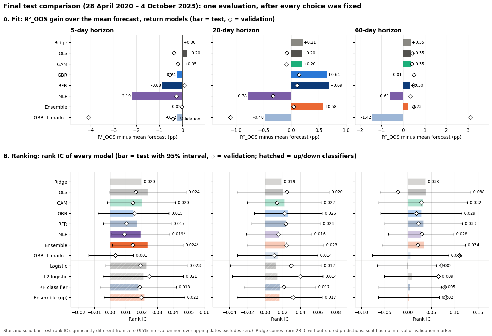
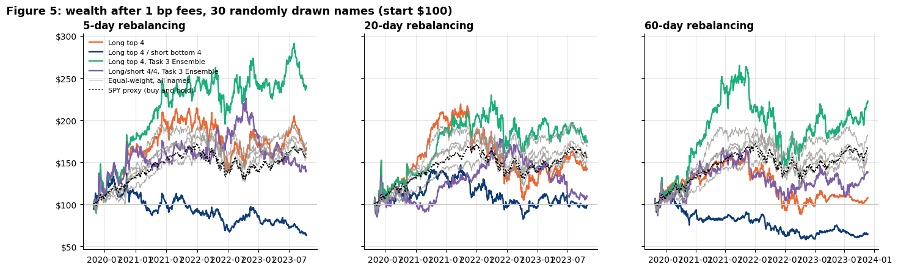
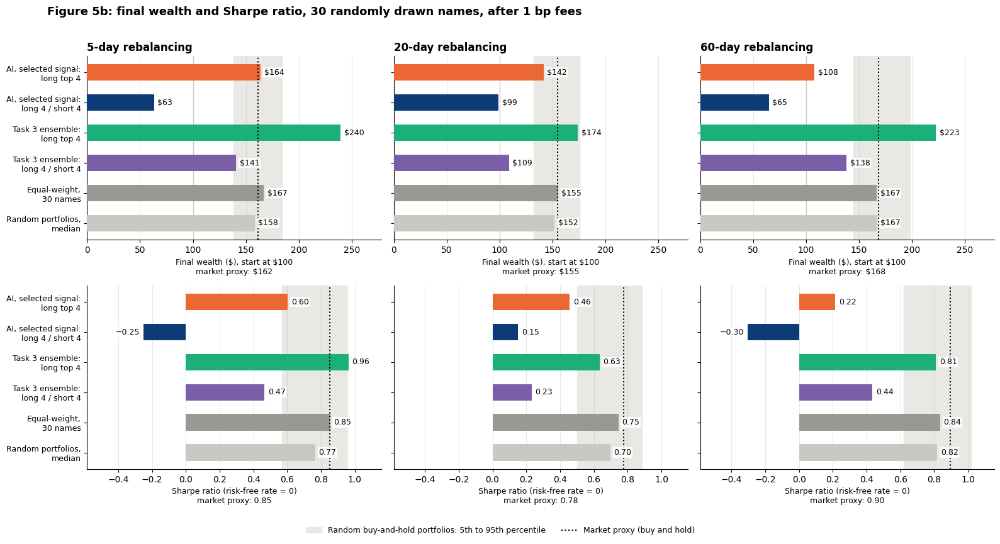
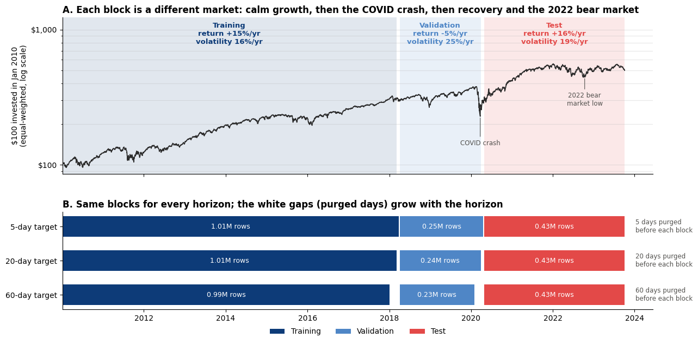
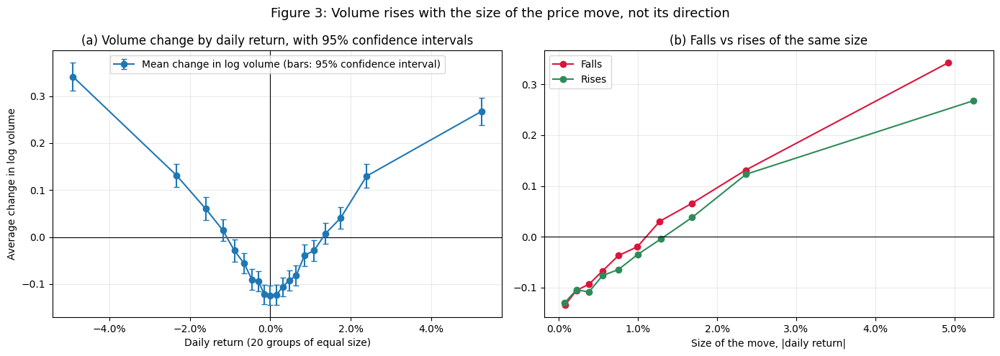

# Lab 4: Predicting Stock Returns with Machine Learning

**Question.** Can past prices and trading volume predict a stock's return over the next 5, 20 or 60 trading days? Do non-linear models (trees, neural networks) beat linear ones? Does a portfolio built on the forecasts beat passive investing after costs?

📓 Notebook: [`PCLab4_ML_Return_Prediction.ipynb`](PCLab4_ML_Return_Prediction.ipynb) (outputs cleared, see [Data](#data-not-included))

## Setup

- **Data.** Course price and volume files for 8 stocks (Task 1), then the **CRSP panel of S&P 500 constituents** (Tasks 2–4): **1.70M stock-days, 756 stocks, Jan 2010 – Oct 2023**.
- **Target.** Cumulative log return over the next *h* ∈ {5, 20, 60} trading days.
- **Predictors.** Past cumulative returns and relative volume over 5/20/60 days (baseline). Task 2 bis adds engineered signals: 1-day reversal, momentum excluding today, 20-day realized volatility, change in log volume, and log firm size.
- **Chronological split with purging.** Train 2010–2018, validation 2018 – Apr 2020 (which includes the COVID crash), test **28 Apr 2020 – 4 Oct 2023**, used once. The last *h* days before each boundary are dropped so targets never overlap. Clipping and scaling are fitted on training data only.
- **Metrics.** R²OOS (relative to a zero forecast, as in Gu, Kelly & Xiu 2020), demeaned R², MSE/MAE, sign accuracy, and the daily **rank IC**. The rank IC t-statistics use non-overlapping dates only.

## What we did

| Task | Content |
|---|---|
| 1 | Data validation and volume analysis. A GOOG volume anomaly (27 Mar – 2 Apr 2014) turned out to be the GOOG/GOOGL share-class split, which we confirmed with CRSP PERMNOs. We also studied how volume relates to returns. |
| 2 | OLS benchmark, Ridge with the penalty chosen on validation, logistic and L2-logistic regression for the sign of returns |
| 2 bis | Extra predictors: engineered stock signals vs market-wide variables |
| 3 | Gradient-boosted trees, random forest, a 3-layer neural network (NN3, averaged over 5 seeds), a GAM (splines + ridge), a random-forest classifier and equal-weight ensembles, all run through one shared tuning and evaluation protocol |
| 4 | A trading strategy on 30 random S&P 500 stocks: long the top 4, rebalanced every *h* days, 1 bp fees. Tested against random portfolios, a market proxy, a placebo with random scores, 20 other random universes, and a 100-stock version. |

## Key findings

**Volume predicts the size of moves, not their direction.** The return–volume relation is V-shaped. Abnormal volume is followed by larger absolute returns the next day (correlation 0.13–0.31) but says nothing about their sign.

**Linear models: almost all of the "skill" is market drift.** OLS reaches a test R²OOS of 0.36%, 0.93% and 2.08% (5/20/60 days). A mean forecast that ignores all predictors scores 0.18%, 0.75% and 2.38%. Ridge adds nothing, since six predictors and about a million observations leave OLS precise already. Rank ICs are positive (0.013–0.022) but not significant.

**Extra signals help only when they are stock-specific.** The engineered stock signals improve the 60-day rank IC from 0.013 to 0.038. Market-wide variables raise in-sample fit but hurt out of sample, which is overfitting to one market regime.

**Non-linear models give no consistent edge.**
- Validation picked the **simplest setting** for almost every model: the shallowest trees and the strongest penalties. This suggests the signal is weak and simple.
- On test, all gains are **below 1 pp of R²OOS**. Trees fit best at 20 days (+0.64 / +0.69 pp over the mean forecast), and the linear models are the most stable across horizons.
- Only the **MLP and the Ensemble** have a statistically significant rank IC (5-day, about 0.02, t ≈ 2.1).
- Gradient boosting with market variables had the best validation result at 60 days (+3.1 pp) and the **worst test result** (−1.42 pp).
- The classifiers predict "up" for 98–100% of stock-days, so their balanced accuracy is about 50%.
- These results agree with Gu, Kelly & Xiu (2020) that predictability is small. Unlike them, we find no clear win for neural networks, plausibly because we use only 10 price/volume signals on large caps over a short test window.

**The AI portfolio does not beat passive investing on a risk-adjusted basis.**

| Long top 4, after 1 bp fees (start $100) | 5-day | 20-day | 60-day |
|---|---:|---:|---:|
| AI portfolio: final wealth | $164 | $142 | $108 |
| Market proxy: final wealth | $162 | $155 | $168 |
| AI portfolio: Sharpe | 0.60 | 0.46 | 0.22 |
| Market proxy: Sharpe | 0.85 | 0.78 | 0.90 |
| Percentile rank among 1,000 random portfolios (wealth) | 67th | 20th | 0th |

- Returns come from **market beta (1.1–1.3)** on volatile, COVID-hit names such as CCL and PVH. Alpha is never significant. The gains were made in 2020 and given back in 2022.
- The **long/short** version loses money at every horizon.
- The Task 3 ensemble looks best ($240 / $174 / $223), but its alpha is insignificant (t ≤ 1.0).
- Across 20 other random universes, the same rule ends between **$108 and $226** at 5 days (5th–95th percentile). A placebo that picks stocks by random scores ends in a similar range ($103–$192), so luck dominates a single concentrated portfolio.

**Bottom line:** in this sample the signals contain no exploitable out-of-sample edge once concentrated into a few stocks and traded with costs. A rank IC of about 0.02 is a real but economically small signal that the noise of a concentrated portfolio swamps.

## Figures

| Wealth paths after fees | Final wealth and Sharpe ratio |
|---|---|
|  |  |

| Chronological split | Volume vs returns |
|---|---|
|  |  |

## Data (not included)

The notebook expects these files next to it. None are part of this repository.

| File | Content | Source |
|---|---|---|
| `Data_PCLab4_Stock_Price.csv`, `Data_PCLab4_Stock_Volume.csv` | Daily prices and volumes of the 8 stocks + S&P 500 | Course material (not redistributed) |
| `crsp_sp500_2007_2023.csv.gz` | CRSP daily stock file, S&P 500 constituents 2007–2023 | WRDS (licensed) |

Fitted models and intermediate tables are cached in `cache/` and `exports/` on the first run. Both folders are excluded by `.gitignore`.
